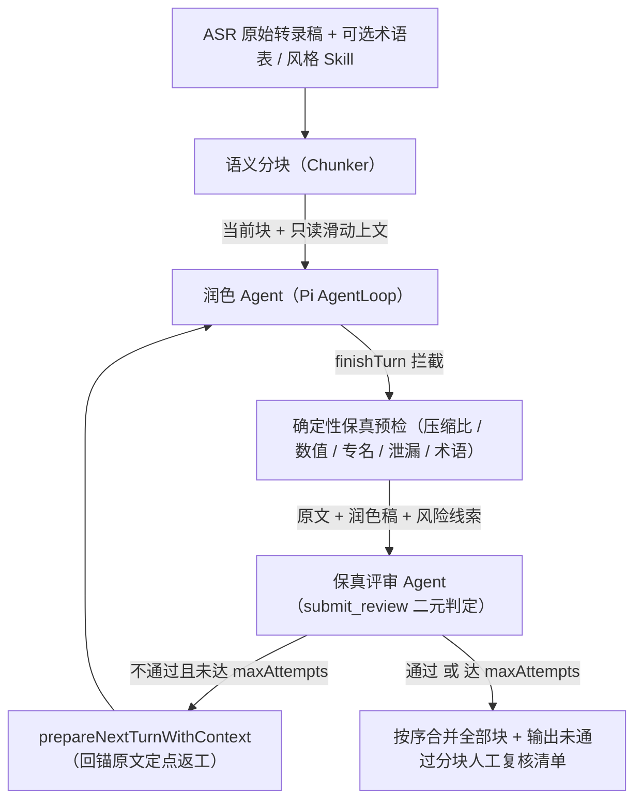

# Pi ASR 转录稿书面化高保真润色 Agent（pi-polisher-agent）

基于 Pi 官方核心包（`@earendil-works/pi-agent-core` 与 `@earendil-works/pi-ai`）搭建的 **ASR 语音转录稿书面化润色双 AgentLoop 工作流**。核心目标不只是“写得通顺”，更是死守**「意思不漂移」**第一底线：

- **默认即 ASR 高保真书面化**：清除口语杂音、合并结巴与口误自我纠错、修正 ASR 同音错别字、理顺流水长句，同时严禁摘要式删减、严禁重排逻辑顺序、严禁改强/改弱原意或脑补观点。
- **语义分块 + 滑动上文（Chunker）**：长篇转录稿自动按自然段/句末边界切块，每块携带上一块末尾只读衔接上文并独立跑质检闭环，防止长文单次生成引发的隐式摘要与中段遗漏。
- **确定性保真预检（Guardrails）**：每轮润色后零模型成本自动核查有效字数压缩/膨胀比、数值与时间锚点、英文专名/缩写、上文重复泄漏、寒暄前缀与术语表未修正误识词，将高风险线索注入评审 Agent 逐条核实。
- **专有名词术语锚点（Glossary）**：支持 `--glossary` 加载同音纠错映射与专名表，同步注入润色 Agent 与评审 Agent，确保整篇长稿术语统一。
- **语义保真优先的双 AgentLoop 闭环**：基于 Pi 原生 `finishTurn` + `prepareNextTurnWithContext` 钩子驱动。独立评审 Agent 以「意思不漂移 = 一票否决」做**通过 / 不通过**二元判定；打回时回锚原始转录稿定点修订；超限未通过的分块会输出精准的人工复核定位清单。
- **附加风格 Skill 可插拔**：在保真底线之上，按需叠加 `formal`、`concise`、`transcript`、`vivid` 或自定义 `SKILL.md`。

> 注：旧包名 `@mariozechner/pi-agent-core` / `@mariozechner/pi-ai` 已官方弃用并迁移至 `@earendil-works/pi-agent-core` / `@earendil-works/pi-ai`。

## 工作流概览



## 文档导航

- **[架构与双 AgentLoop 设计说明](docs/architecture.md)**：防意思漂移四层设计、模块职责、分块与滑动上文、确定性预检、Pi 原生循环钩子与 `submit_review` 兜底机制。
- **[风格 Skill 使用与开发指南](docs/skills-guide.md)**：内置附加风格说明、多风格叠加规则，以及自定义 `SKILL.md` 编写规范。
- **[CLI、环境变量与编程 API 参考手册](docs/api-and-cli.md)**：完整 CLI 参数、术语表文件格式、交互命令、环境变量优先级、TypeScript API 与离线测试说明。
- **[实践调优与常见问题排查](docs/troubleshooting.md)**：分块调优、防漂移排查、确定性预检告警解读、Windows 多行输入与端点排障。
- **[贡献指南](CONTRIBUTING.md)** · **[变更日志](CHANGELOG.md)** · **[Agent 开发约定](AGENTS.md)**

## 项目结构

```text
├── docs/
│   ├── architecture.md       # 架构、防语义漂移机制与双 AgentLoop 设计说明
│   ├── skills-guide.md       # 附加风格 Skill 使用与开发指南
│   ├── api-and-cli.md        # CLI、术语表、环境变量与编程 API 参考手册
│   └── troubleshooting.md    # 实践调优与常见问题排查
├── skills/
│   ├── formal/SKILL.md       # 正式商务 / 公文风格叠加 Skill
│   ├── concise/SKILL.md      # 精炼干练风格叠加 Skill
│   ├── transcript/SKILL.md   # 视频/音频转录文稿书面化强化 Skill
│   └── vivid/SKILL.md        # 生动文采风格叠加 Skill
├── src/
│   ├── chunker.ts            # 长转录稿语义分块与只读滑动上文提取
│   ├── glossary.ts           # 专有名词 / ASR 误识纠错术语表解析与注入
│   ├── guardrails.ts         # 零成本确定性保真预检（压缩比/数值/专名/泄漏/前缀/术语）
│   ├── prompts.ts            # ASR 高保真润色员与评审员提示词、返工回锚指令构造
│   ├── reviewer.ts           # 评审 Agent 与 submit_review 工具（二元判定 + JSON 兜底）
│   ├── skills.ts             # 风格 Skill 扫描、Frontmatter 解析、加载与注入格式化
│   ├── models.ts             # Pi Models / Provider 配置（内置 + 自定义 OpenAI 兼容端点）
│   ├── workflow.ts           # 分块调度与双 AgentLoop 闭环编排（polishText / createPolisherAgent）
│   ├── index.ts              # CLI 入口（文件、参数、管道、交互模式、分块人工复核清单）
│   └── workflow.test.ts      # 基于 Pi fauxProvider 的离线全链路自动化测试
├── AGENTS.md                 # 面向 AI Coding Agent 的核心不变量与按需文档索引
├── CHANGELOG.md              # 版本变更日志
├── CONTRIBUTING.md           # 贡献与本地开发指南
├── glossary.example.txt      # 专有名词与 ASR 误识纠错术语表示例模板
├── .env.example              # 环境变量配置示例
├── package.json
└── tsconfig.json
```

## 快速开始

### 1. 安装依赖

```bash
npm install
```

### 2. 配置模型环境

复制 `.env.example` 为 `.env` 并任选一种方式配置：

```bash
cp .env.example .env
```

- **方式一：Pi 内置 Provider** — 填写 `OPENAI_API_KEY`、`ANTHROPIC_API_KEY`、`GEMINI_API_KEY`、`DEEPSEEK_API_KEY`、`OPENROUTER_API_KEY` 等任意一项，可选设置 `PI_PROVIDER`、`PI_MODEL`、`PI_THINKING_LEVEL`。
- **方式二：自定义 OpenAI 兼容接口** — 配置 `CUSTOM_BASE_URL`、`CUSTOM_API_KEY`、`CUSTOM_MODEL`（以及可选的 `CUSTOM_MAX_TOKENS`、`CUSTOM_CONTEXT_WINDOW`、`CUSTOM_REASONING`）。
- **可选：评审 Agent 独立模型** — 默认复用润色 Agent 配置；也可通过 `REVIEW_PROVIDER`、`REVIEW_MODEL`、`REVIEW_THINKING_LEVEL` 或对应 CLI 参数单独指定。

### 3. 常用命令

```bash
# 默认直接执行 ASR 高保真书面化润色 + 确定性预检 + 评审闭环（最多 3 轮）
npm run polish -- "嗯就是说，一开始我们以为是网络慢，然后查了半天发现其实是接口超时了，所以就先把超时时间调大了一点。"

# 处理长篇 ASR 转录稿文件（默认每 2000 字自动语义分块 + 滑动上文）
npm run polish -- --file raw_asr.txt --output polished.txt

# 配合专有名词 / 同音纠错术语表，并自定义分块大小与最大返工轮次
npm run polish -- --file raw_asr.txt --glossary glossary.txt --chunk-size 1800 --max-attempts 3 --output polished.txt

# 在 ASR 高保真底线上叠加正式商务风格（如整理会议纪要）
npm run polish -- --skill formal --file meeting_asr.txt --output minutes.txt

# 查看所有可用的附加风格 Skill
npm run polish -- --list-skills

# 关闭评审闭环，退化为单轮流式直出
npm run polish -- --no-review "需要快速单轮直出的转录文本"

# 管道模式（stderr 输出分块、预检与评审日志，stdout 仅输出最终定稿）
cat raw_asr.txt | npm run polish -- --glossary glossary.txt > polished.txt

# 进入交互式模式（支持 /skills、/skill、/glossary、/chunk-size、/review、/max-attempts）
npm run polish
```

### 术语表文件示例（`glossary.txt`）

```text
# 格式：常见 ASR 误识1, 误识2 -> 规范写法 | 可选说明
白莲, 白连 -> 百炼 | 阿里云大模型平台
缓存鸡穿 => 缓存击穿
Pi AgentLoop: 项目核心循环框架
DeepSeek
```

## 作为模块调用

```typescript
import { loadGlossaryFile } from "./src/glossary.js";
import { resolveModelConfig } from "./src/models.js";
import { polishText } from "./src/workflow.js";

const { models, model, thinkingLevel } = await resolveModelConfig();
const glossary = await loadGlossaryFile("./glossary.txt");

const result = await polishText(rawTranscript, {
  models,
  model,
  thinkingLevel,
  glossary,
  chunkSize: 2000,
  enableGuardrails: true,
  review: true,
  maxAttempts: 3,
  onLoopEvent: (event) => {
    if (event.type === "review_complete") {
      console.error(
        `[分块 ${event.chunkIndex}/${event.chunkCount}][第 ${event.attempt} 轮] ${event.review.passed ? "通过" : "不通过"}：${event.review.summary}`,
      );
    }
  },
});

console.log("全部分块通过：", result.passed, "未通过块数：", result.failedChunks.length);
console.log(result.polishedText);
```

完整参数与类型定义请查阅 [CLI、环境变量与编程 API 参考手册](docs/api-and-cli.md)。

## 测试与构建

```bash
npm run typecheck
npm test
npm run build
```
