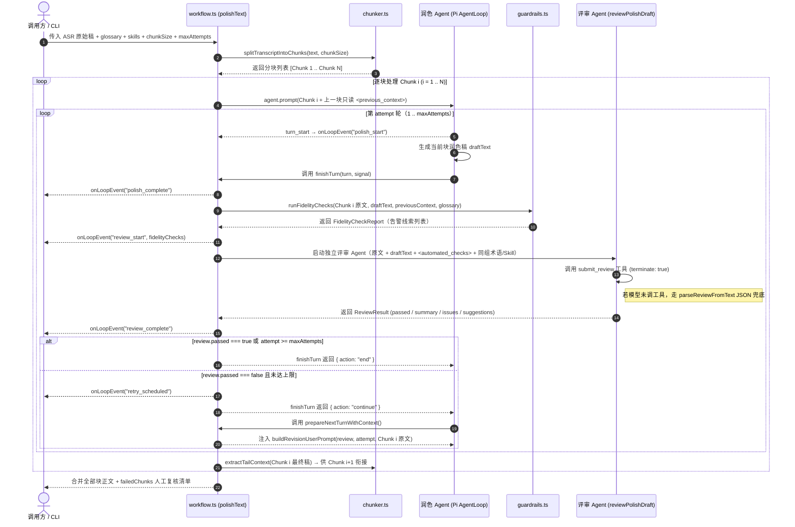

# 架构与双 AgentLoop 设计说明

本文档说明 `pi-polisher-agent` 面向 **ASR 转录稿书面化润色** 场景的防漂移架构设计、模块职责，以及基于 Pi 原生 AgentLoop 钩子实现的「分块 → 润色 → 确定性预检 → 保真评审 → 回锚返工」闭环机制。

---

## 1. 核心目标与设计原则

ASR 语音转录稿润色与普通自由改写的最大区别在于：**「意思不漂移」的优先级远高于文采修辞**。项目围绕 4 条架构原则防漂移：

1. **语义保真作为一票否决项**：默认角色即 ASR 高保真编辑与保真评审员，严格守住逻辑链条（因果、转折、否定、条件、程度限定词）、讲述顺序与信息完整度；附加风格 Skill 只能在保真前提下叠加生效。
2. **分块隔离 + 只读滑动上文**：中长篇转录稿自动切分为独立语义块，避免单次大段生成导致的隐式摘要与中段遗漏；每块独立执行评审与打回，局部返工不影响其余已通过分块。
3. **规则硬守卫 + LLM 语义评审互补**：在评审 Agent 之前加入零模型成本的确定性预检（压缩比、数值/时间、英文专名、上文重复泄漏、寒暄前缀、术语未修），把可量化的风险线索直接喂给评审 Agent 核实，避免模型被流畅文风“骗过”。
4. **双 Agent 同标 + 返工回锚原文**：术语表（`<glossary>`）与附加风格 Skill（`<style_skills>`）同步注入润色与评审双端；打回修订时显式回锚原始转录稿（`<original_text_reference>`），防止多轮返工在旧草稿上越改越飘。

---

## 2. 模块职责划分

| 模块 | 文件路径 | 核心职责 |
| :--- | :--- | :--- |
| 语义分块 | `src/chunker.ts` | 将长篇 ASR 转录稿按自然段 / 句末标点 / 弱停顿边界切分，并从上一块润色稿末尾提取只读滑动上文 |
| 术语锚点 | `src/glossary.ts` | 解析文本与 JSON 格式术语表 / ASR 误识映射，去重并格式化为 `<glossary>` 注入块 |
| 确定性预检 | `src/guardrails.ts` | 零模型成本检测有效字数压缩/膨胀比、数值与时间锚点、英文专名、上文泄漏、寒暄前缀及未修术语 |
| 提示词构造 | `src/prompts.ts` | 定义 ASR 高保真润色员 / 评审员系统提示词，组装术语表与 Skill，构造分块提示、预检评审提示与回锚返工指令 |
| 评审执行 | `src/reviewer.ts` | 封装独立评审 `Agent`、注册 `submit_review` 工具（`terminate: true`）以及非工具调用时的 JSON 兜底解析 |
| 风格 Skill | `src/skills.ts` | 扫描 `skills/<name>/SKILL.md`、解析 YAML Frontmatter、按名去重加载与 `<style_skills>` 格式化 |
| 模型配置 | `src/models.ts` | 整合 Pi 内置 Provider 与自定义 OpenAI 兼容端点，解析 `k/m` Token 简写与思考强度 |
| 闭环编排 | `src/workflow.ts` | 串联分块调度、滑动上文传递、Pi `finishTurn` / `prepareNextTurnWithContext` 钩子与分块汇总报告 |
| CLI 入口 | `src/index.ts` | 解析命令行参数、调度输入源（文件 / 参数 / 管道 / 交互模式）、分离 `stdout`/`stderr` 并打印未通过分块人工复核清单 |
| 自动化测试 | `src/workflow.test.ts` | 基于 Pi `fauxProvider` 的离线全链路单元测试（14 个测试用例） |

---

## 3. 分层提示词与上下文组装

润色 Agent 与评审 Agent 共用同一套三段式系统提示词拼装逻辑：

```text
Polisher System Prompt = POLISHER_SYSTEM_PROMPT + [formatGlossaryForInjection(glossary)] + [formatSkillsForInjection(skills)]
Reviewer System Prompt = REVIEWER_SYSTEM_PROMPT + [formatGlossaryForInjection(glossary)] + [formatSkillsForInjection(skills)]
```

- **默认不传 `--skill`**：即启用 ASR 高保真书面化基础角色，不注入 `<style_skills>`。
- **传入 `--glossary`**：同步注入 `<glossary>`，规范全篇专有名词与同音纠错映射。
- **叠加 `--skill`**：在保真底线之上同步注入 `<style_skills>`，两段均按传入顺序保留并去重。

---

## 4. 分块与双 AgentLoop 闭环执行流程



### 关键机制说明

1. **三层兜底切块（`src/chunker.ts`）**：
   - 优先按段落边界（空行或单换行）聚合到 `chunkSize`（默认 `2000` 字）以内；
   - 超长单段（常见于无换行 ASR 文本）按强句末标点（`。！？!?；;`）切分；
   - 仍超长的无标点流式转录文本按弱停顿标点（`，,、：:`）或空白切分，最后才硬切，最大程度保护语义完整。
   - 相邻块之间通过 `extractTailContext()` 提取上一块末尾 1～2 句（最多 `240` 字）封装为 `<previous_context>`，并明确告知模型仅供承接代词与语气、严禁重复输出。
2. **零成本确定性保真预检（`src/guardrails.ts`）**：
   - 在调用评审 Agent 前自动执行 6 项检查：
     - `compression_too_high` / `expansion_too_high`：剥离常见口语填充词后计算净字数比例（原文有效字数 `>= 40` 时启用，默认安全区间 `0.55 ~ 1.35`）。
     - `missing_numbers` / `added_numbers`：比对数值、小数、百分比、时间、带 `k/m/万/亿` 单位的锚点，并对 `0~99` 阿拉伯/中文数字与 `9点 ↔ 9:00` 做等价容错以降低误报。
     - `missing_terms`：比对英文缩写/专名标识符（忽略常见英文虚词）。
     - `context_leak`：检测润色稿开头是否误将 `<previous_context>` 末尾窗口复写出来。
     - `chatty_preamble`：检测开头是否夹带“好的，以下是润色后…”等非正文寒暄。
     - `unfixed_glossary_alias`：检测原文中出现过的术语表误识词在润色稿中是否仍残留未修。
   - 这些告警以 `<automated_checks>` 形式交给评审 Agent 结合语境最终裁决——既避免纯正则误杀合理纠错（如口误自我纠错被删除），又把真正的高风险漂移点高亮到评审面前。
3. **回锚原文的定点返工（`prepareNextTurnWithContext`）**：
   - 当评审不通过时，`buildRevisionUserPrompt()` 不仅注入 `summary`、`issues`、`suggestions`，还会附带 `<original_text_reference>` 原始转录稿片段，强制润色 Agent 对照原文做定点修复，避免多轮迭代在旧草稿上持续漂移。
4. **结构化评审保障（`src/reviewer.ts`）**：
   - 主路径通过 `submit_review` 工具（`terminate: true`）单次请求直接结束评审循环；
   - 若部分模型未调用工具而返回文本，通过 `parseReviewFromText()` 提取 JSON 兜底，并经 `normalizeReviewResult()` 规范化。

---

## 5. 流隔离、异常处理与人工复核定位

- **标准流分离**：`stderr` 输出模型横幅、分块进度、确定性预检命中项、评审结论与人工复核清单；`stdout` **仅输出最终合并后的润色正文**，天然适配管道与文件重定向。
- **分块超限人工复核清单**：若长文中个别分块达到 `maxAttempts` 仍未通过评审，工作流不会中断整篇任务，而是保留该块最后一轮修订稿，同时在 `result.failedChunks` 与 CLI `stderr` 中精确列出未通过分块编号、原文开头片段与未解决问题，人工只需复核这几块即可。
- **异常与中断传播**：模型 `error`/`aborted`、空输出或评审阶段异常会立刻终止当前循环并向外抛出清晰错误；外部 `AbortSignal` 会级联中断正在运行的评审 Agent。
